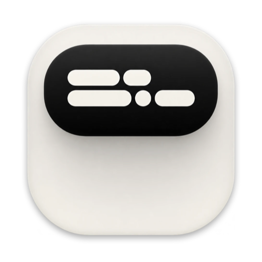
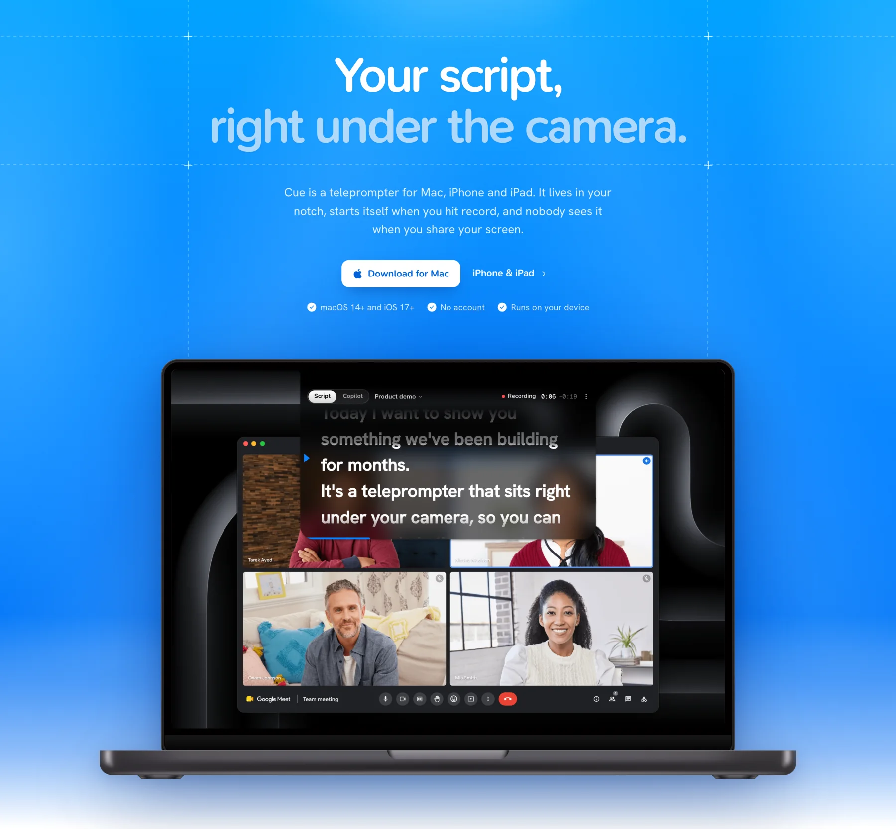
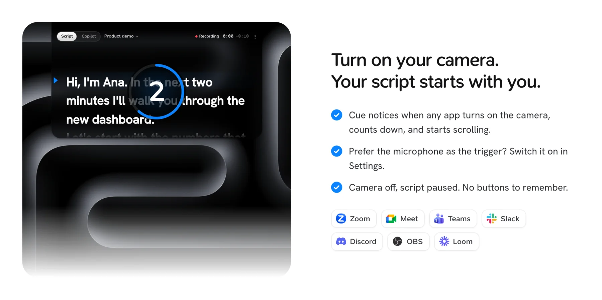
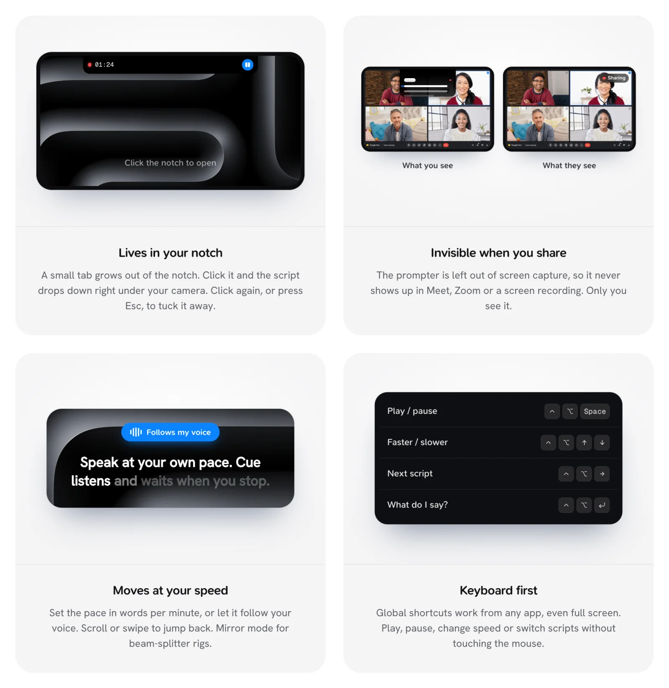
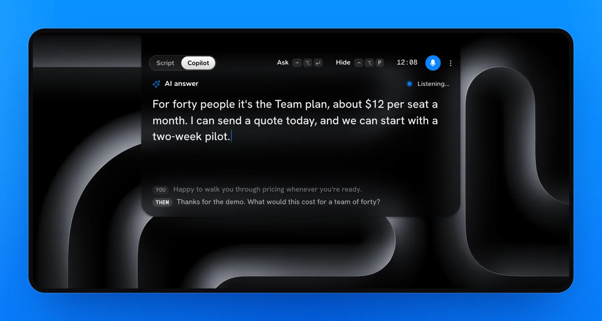
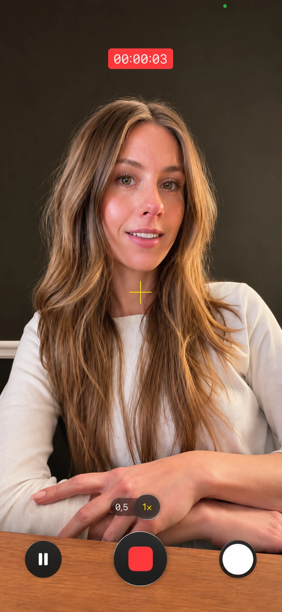
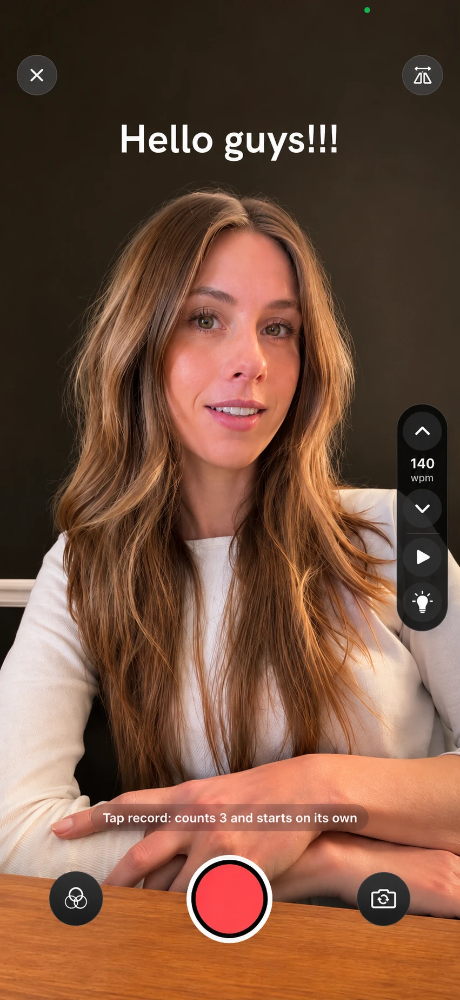

<p align="center">
  
</p>

<h1 align="center">Cue</h1>

<p align="center">
  Your script, right under the camera.<br>
  A teleprompter for <b>Mac</b>, <b>iPhone</b> and <b>iPad</b>. It lives in your notch, starts itself when you hit record, and nobody sees it when you share your screen.
</p>

<p align="center">
  <a href="https://manuekle.github.io/cue/"><b>Website</b></a> ·
  <a href="https://github.com/Manuekle/cue/releases/latest/download/Cue-macOS.zip"><b>Download for Mac</b></a> ·
  <a href="#build-it"><b>Build it</b></a>
</p>

<p align="center">
  
</p>

> Cue used to be called **Pronter**. Your scripts, settings and permissions carry over.

## Mac



- **Starts on its own.** When any app turns on the camera (Zoom, Meet, Teams, FaceTime, QuickTime, OBS…), Cue opens your script under the notch, counts 3, 2, 1 and starts scrolling. Camera off, script paused. The microphone can be the trigger instead.
- **Lives in your notch.** A small black tab grows out of the notch with the status and the time. Click the notch to open the prompter, click again (or press Esc) to tuck it away. On Macs without a notch it sits just below the menu bar.
- **Invisible when you share.** The prompter is left out of screen capture, so it never shows up in Meet, Zoom or a screen recording. Only you see it.
- **Always there.** It stays above full-screen apps and keeps running in the menu bar after you close the window.



### Copilot



Cue listens to the call and tells you what to say.

1. Open **Copilot** in the sidebar and write some context: who you are, what the call is about, your goals and the numbers you need.
2. Press the mic. **Whisper** (WhisperKit, on your Mac) transcribes your microphone (**You**) and the system audio (**Them**).
3. When the other person stops talking, a one-to-three-sentence reply appears, ready to read, in the language of the conversation. Press ⌃⌥↩ to ask at any time.

| Engine | Where it runs |
|---|---|
| Apple Intelligence (macOS 26+) | On your Mac |
| Ollama (`localhost:11434`, e.g. `qwen2.5:7b`) | On your Mac |
| OpenAI, Gemini, Claude, Muse, Ollama Cloud | In the cloud, with your own key (stored in the Keychain) |

Whisper downloads on first use (Fast 145 MB, Balanced 480 MB, Accurate 630 MB) to `~/Library/Application Support/Pronter/Models`. Cue asks for **Microphone** and **Screen & System Audio Recording** access; only the audio is used. Wear headphones so your mic doesn't pick up the other person.

### Shortcuts

They work from any app, even in full screen.

| Shortcut | Action |
|---|---|
| ⌃⌥ Space | Play / pause |
| ⌃⌥ P | Open / tuck away the prompter |
| ⌃⌥ R | Back to the start |
| ⌃⌥ ↑ / ↓ | Faster / slower |
| ⌃⌥ ← / → | Previous / next script |
| ⌃⌥ ↩ | Copilot: what do I say? |
| ⌃⌥ L | Copilot: listen / stop |
| ⌥⌘ 1–9 | Go to script 1–9 in the list |
| ⌃⌥⌘ 1–9 / 0 | Switch to session 1–9 / show all |

With the prompter in front: Space, ↑/↓, ←/→, 1–9, + / −, R, M (mirror) and Esc. The scroll wheel or trackpad moves the text.

## iPhone and iPad

<p align="center">
  
  &nbsp;&nbsp;&nbsp;
  
</p>

| Mode | What it does |
|---|---|
| **Floating** | Puts your script in a Picture in Picture window on top of **any app**: Camera, Instagram, TikTok, WhatsApp, Zoom… Hit record in that app and Cue notices, counts down and starts on its own. Stop recording and it pauses. Horizontal or vertical. |
| **Record** | Cue's own camera, with the script next to the lens. A countdown, then the video and the text start together. **Follows my voice** scrolls while you talk and waits when you pause. Color looks (Warm, Cinema, B&W…), a studio light and a portrait-style blurred background. Videos go to Photos. |
| **Read** | A full-screen prompter, no camera. |

On iPhone and iPad, Cue is just the teleprompter. The Copilot (transcription and AI replies) is a Mac feature.

While reading: tap to pause, swipe to jump back or ahead, pinch to resize the text, and use − / + to change the speed in words per minute.

**How it knows you're recording:** iOS doesn't tell an app when another one starts recording. While the floating window is open, Cue keeps an audio session running. When another app starts recording, iOS interrupts that session, and that's the signal to count down and start. If an app doesn't do this, tap ▶.

## Sessions

Group your scripts by project, channel or client. Each script belongs to one session; **All** shows every script. New scripts are created in the active session. Deleting a session doesn't delete its scripts: they move to **All**.

- **iPhone/iPad:** the session bar above the list, and the folder menu to create, rename or delete. Long-press a script → *Move to session*.
- **Mac:** the picker in the sidebar and in the menu bar menu. Right-click a script → *Move to session*.

## Build it

Requires Xcode 16 or later, macOS 14+ and iOS 17+. The project is generated with [XcodeGen](https://github.com/yonaskolb/XcodeGen) from `project.yml`:

```bash
xcodegen generate
```

```bash
open Cue.xcodeproj
```

- **Mac:** scheme `CueMac` → Run. The build is `Cue.app`; copy it to `/Applications` to keep it installed.
- **iPhone/iPad:** scheme `Cue`, your device as the destination → Run.

End-to-end test on a real iPhone (it opens the floating window, records with the Camera app and checks the text started on its own):

```bash
xcodebuild test -project Cue.xcodeproj -scheme Cue -destination 'id=<iPhone UDID>' -allowProvisioningUpdates
```

English is the base language; Spanish lives in `Shared/Localizable.xcstrings`. After adding strings, build with `SWIFT_EMIT_LOC_STRINGS=YES` and run `tools/sync-strings.py`.

## Project layout

| Folder | What's inside |
|---|---|
| `Shared/` | Scripts, sessions, settings, the prompter engine (countdown, speed, position) and the text view |
| `Shared/Theme.swift` | Visual style: black glass, blue `#0A84FF`, SN Pro, Hanken Grotesk and Geist Mono, Hugeicons |
| `macOS/` | The notch panel, camera and microphone detection, global shortcuts |
| `macOS/Copilot/` | Audio capture, Whisper (WhisperKit) and the AI engines |
| `iOS/` | Camera with filters, floating window (PiP), recording detection and the reader |
| `site/` | The website, static HTML published to GitHub Pages |
| `tools/` | Hugeicons conversion, string sync, and `tools/og/` for the social preview image |

## Credits

Fonts: SN Pro, Hanken Grotesk and Geist Mono (OFL). Icons: [Hugeicons](https://hugeicons.com) (MIT). App logos on the website: [svgl](https://svgl.app).
